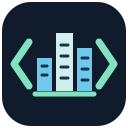
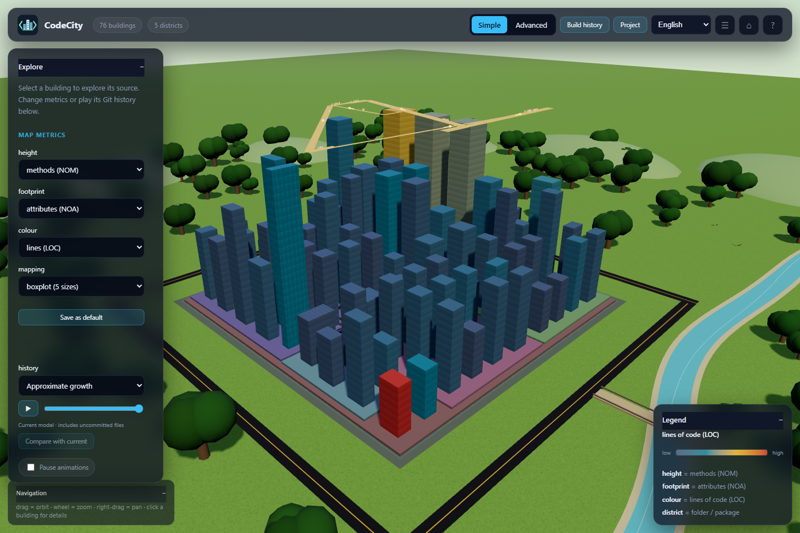

<p align="center">
  
</p>

# CodeCity

[English](README.md) · [فارسی](README.fa.md)

[](https://www.npmjs.com/package/codecity-viewer)
[](https://marketplace.visualstudio.com/items?itemName=Amin-Tz.codecity)
[](https://marketplace.visualstudio.com/items?itemName=Amin-Tz.codecity)
[](https://marketplace.visualstudio.com/items?itemName=Amin-Tz.codecity)

پروژهٔ خود را به شکل یک **شهر سه‌بعدی تعاملی** کاوش کنید. کلاس‌ها و ماژول‌ها به
ساختمان و پوشه‌ها به محله تبدیل می‌شوند. با انتخاب یک ساختمان، ساختمان‌های مرتبط
روشن می‌شوند و وابستگی‌ها در نقشه‌ای تعاملی کنار شهر نمایش داده می‌شوند.
CodeCity کد منبع را به‌صورت محلی بررسی می‌کند، بدون نصب یا اجرای کد پروژهٔ شما.

## نصب از npm (روش اصلی)

**صفحهٔ بسته در npm:** [npmjs.com/package/codecity-viewer](https://www.npmjs.com/package/codecity-viewer)

```bash
npm install -g codecity-viewer
codecity .
```

**آخرین نسخه: 0.4.2.** پیش‌نیاز: **Node.js نسخهٔ 22.13.0 یا جدیدتر** و npm.
به نصب Git، کلون مخزن یا ساخت پروژه نیازی نیست. Git فقط برای قابلیت‌های تاریخچه
لازم است. روش‌های مبتنی بر مخزن مخصوص توسعه‌اند و در بخش
[توسعه و مستندات](#توسعه-و-مستندات) آمده‌اند.

**افزونهٔ وی‌اس‌کد:** افزونهٔ
[CodeCity 3D Viewer](https://marketplace.visualstudio.com/items?itemName=Amin-Tz.codecity)
را از Marketplace نصب کنید یا در بخش Extensions (کلید `Ctrl+Shift+X`) عبارت
**CodeCity** را جست‌وجو کنید. دستور
`code --install-extension Amin-Tz.codecity` هم در دسترس است.



## قابلیت‌ها

- پروژه‌های چندزبانه را باز کنید: JavaScript/TypeScript، Python، C/C++، Java، C#، Go و زبان‌های دیگر.
- تعداد متدها را به ارتفاع، تعداد ویژگی‌ها را به مساحت پایه و تعداد خطوط کد را به رنگ نگاشت کنید؛ تنظیمات پیش‌فرض را تغییر دهید و ذخیره کنید.
- با انتخاب ساختمان‌ها، اعضا، وابستگی‌ها، شواهد معیارها و پیش‌نمایش کد منبع را ببینید.
- تاریخچهٔ Git را پخش کنید، ساختار کامیت‌های گذشته را ببینید و آن‌ها را با پروژهٔ فعلی مقایسه کنید.
- با حالت ساده شروع کنید؛ برای فیلترها، بررسی‌های تحلیلی و گزارش اسکن از حالت پیشرفته استفاده کنید.
- از بین هشت زبان رابط کاربری انتخاب کنید؛ فارسی و عربی چیدمان راست‌به‌چپ دارند.

نسخه‌های همراه three.js و پارسرها باعث می‌شوند برنامهٔ نصب‌شده آفلاین اجرا شود.
Git اختیاری است و برای تاریخچه لازم می‌شود. معیارها و تخمین وابستگی‌ها به بررسی
کد کمک می‌کنند؛ کیفیت کد یا کامل بودن گراف فراخوانی هنگام اجرا را اثبات نمی‌کنند.

در پروژه‌های بزرگ، نمایشگر هنگام ادامهٔ اسکن باز می‌شود. برای بیش از ۲۵۶ فایل
JavaScript/TypeScript یا ۴ مگابایت کد این زبان‌ها، معیارهای نحوی و وابستگی‌های
محلی ماژول‌ها حفظ می‌شوند و تحلیل پرمصرف فراخوانی‌ها و نام‌های مستعار با کامپایلر
انجام نمی‌شود؛ این محدودیت در گزارش اسکن مشخص است. سقف اسکن ۲۰٬۰۰۰ فایل منبع،
۲ مگابایت برای هر فایل و دو دقیقه برای تحلیل است.

## شروع کار

**آخرین نسخه: [0.4.2](https://github.com/Amin-Tgz/CodeCity/releases/tag/v0.4.2).**

### ۱. استفاده از CLI نصب‌شده (Windows, macOS, Linux)

```bash
# اجرا در هر ترمینال:
codecity
# یا برای باز کردن مستقیم پوشه جاری:
codecity .
# یا برای باز کردن مستقیم یک پروژه:
codecity /path/to/project
```

همچنین می‌توانید بستهٔ منتشرشده را بدون نصب سراسری اجرا کنید:

```bash
npx --yes --package=codecity-viewer codecity /path/to/project
```

آخرین نسخهٔ npm برابر **0.4.2** است. برای نصب دقیق همین نسخه، از دستور
`npm install -g codecity-viewer@0.4.2` استفاده کنید. Git فقط برای قابلیت‌های
تاریخچهٔ Git لازم است.

### ۲. افزونه وی‌اس‌کد (VS Code Extension)
برای کاوش شهر سه‌بعدی مستقیماً داخل Visual Studio Code. این افزونه در
[Visual Studio Marketplace](https://marketplace.visualstudio.com/items?itemName=Amin-Tz.codecity) منتشر شده است:
1. افزونهٔ **CodeCity 3D Viewer** را از [صفحهٔ Marketplace](https://marketplace.visualstudio.com/items?itemName=Amin-Tz.codecity) نصب کنید یا آن را در بخش Extensions (کلید `Ctrl+Shift+X`) جست‌وجو کنید.
2. با کلیک روی آیکون `CodeCity` در نوار وضعیت، آیکون CodeCity در نوار فعالیت، یا کلیک‌راست روی هر پوشه در فایل اکسپلورر و انتخاب **CodeCity: Open 3D View**، شهر سه‌بعدی باز می‌شود.

نصب از خط فرمان:

```bash
code --install-extension Amin-Tz.codecity
```

اگر بستهٔ آفلاین می‌خواهید، فایل `codecity-0.4.2.vsix` را از
[ریلیز v0.4.2](https://github.com/Amin-Tgz/CodeCity/releases/tag/v0.4.2) دانلود کنید،
`Ctrl+Shift+P` را بزنید، `Extensions: Install from VSIX...` را انتخاب کرده و
فایل را برگزینید.

برای دستورها، تنظیمات و رفع اشکال، [README افزونه](extensions/vscode/README.md) را ببینید.

### قابلیت‌های جدید و کلیدی این نسخه:
- **باز کردن پوشهٔ پروژه در فایل منیجر**: دکمهٔ «📁 باز کردن پوشه» در بالای صفحه برای دسترسی مستقیم به پوشهٔ ریشه.
- **رفع باگ Open in File Manager**: عملکرد دقیق در ویندوز و لینوکس بدون پنهان ماندن پنجره.
- **باز کردن مستقیم در ادیتور**: انتخاب ادیتور دلخواه (VS Code، Cursor یا پیش‌فرض سیستم) و پرش به سطر مشخص به جای پیش‌نمایش سادهٔ متنی.
- **دکمهٔ نمایش کمتر / جمع کردن**: در نقشهٔ وابستگی‌ها (Dependency Map) برای مدیریت گره‌های نمایش‌داده‌شده.
- **فیلتر تعاملی پوشه‌ها و ناحیه‌ها**: با نمایش وضعیت روشن/خاموشِ مشخص و دکمهٔ تاگل.
- **بخش Help غنی‌شده**: همراه با ایموجی‌ها، دیاگرام سه‌بعدی ابعاد ساختمان و راهنمای تصویری کنترل‌های ماوس و کیبورد.

برای گزینه‌های نصب و حذف، اجراکننده، کنترل‌ها، استثناهای اسکن، قواعد معیارها و
محدودیت‌های تحلیل، [راهنما](docs/GUIDE.md) را ببینید.

## توسعه و مستندات

مخزن، آرشیو سورس GitHub و نصب‌کننده‌های سورس مخصوص توسعهٔ CodeCity یا امتحان
تغییرات منتشرنشده‌اند. برای راه‌اندازی محیط توسعه:

```bash
git clone https://github.com/Amin-Tgz/CodeCity.git
cd CodeCity
npm start
# باز کردن مستقیم یک پروژه:
npm start -- --root /path/to/project
# اختیاری: نصب همین سورس به‌عنوان دستور سراسری:
npm install -g .
```

برای امتحان شاخهٔ توسعهٔ فعلی بدون کلون کردن:

```bash
npx --yes --package=https://codeload.github.com/Amin-Tgz/CodeCity/tar.gz/refs/heads/main codecity
```

این دستورها از کد در حال توسعه استفاده می‌کنند.
[نصب‌کننده‌های سورس](docs/GUIDE.md#source-installers-development-only) هم می‌توانند
یک نسخهٔ خصوصی از Node را برای این محیط توسعه آماده کنند.

برای بررسی‌های توسعه:

```bash
npm test
# فقط هنگام به‌روزرسانی پارسرهای همراه یا پردازشگر تحلیل:
npm ci
npm run build:parsers
```

- [راهنمای کامل](docs/GUIDE.md): استفاده، معماری، بررسی‌های مرورگر و بنچمارک‌ها.
- [افزونهٔ وی‌اس‌کد](extensions/vscode/README.md): دستورها، تنظیمات و رفع اشکال.
- [پژوهش](docs/RESEARCH.md): تحلیل پروژه‌های واقعی و محدودیت‌های باقی‌مانده.
- [بازبینی](docs/REVIEW.md): یافته‌های ثبت‌شده و بررسی صحت عملکرد.
- [نتایج تست سرتاسری](docs/E2E.md): تست مرورگر روی پروژه‌های عمومی.

استعارهٔ شهر برگرفته از مقالهٔ *Visualizing Software Systems as Cities* نوشتهٔ
Richard Wettel و Michele Lanza است (VISSOFT 2007).
