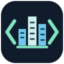
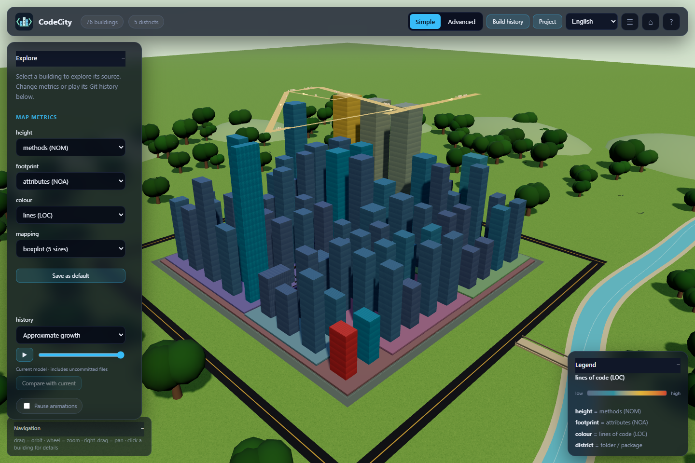

<p align="center">
  
</p>

# CodeCity

[English](README.md) · [فارسی](README.fa.md)

پروژهٔ خود را به شکل یک **شهر سه‌بعدی تعاملی** کاوش کنید. کلاس‌ها و ماژول‌ها به
ساختمان و پوشه‌ها به محله تبدیل می‌شوند. با انتخاب یک ساختمان، ساختمان‌های مرتبط
روشن می‌شوند و وابستگی‌ها در نقشه‌ای تعاملی کنار شهر نمایش داده می‌شوند.
CodeCity کد منبع را به‌صورت محلی بررسی می‌کند، بدون نصب یا اجرای کد پروژهٔ شما.



## قابلیت‌ها

- پروژه‌های چندزبانه را باز کنید: JavaScript/TypeScript، Python، C/C++، Java، C#، Go و زبان‌های دیگر.
- تعداد متدها را به ارتفاع، تعداد ویژگی‌ها را به مساحت پایه و تعداد خطوط کد را به رنگ نگاشت کنید؛ تنظیمات پیش‌فرض را تغییر دهید و ذخیره کنید.
- با انتخاب ساختمان‌ها، اعضا، وابستگی‌ها، شواهد معیارها و پیش‌نمایش کد منبع را ببینید.
- تاریخچهٔ Git را پخش کنید، ساختار کامیت‌های گذشته را ببینید و آن‌ها را با پروژهٔ فعلی مقایسه کنید.
- با حالت ساده شروع کنید؛ برای فیلترها، بررسی‌های تحلیلی و گزارش اسکن از حالت پیشرفته استفاده کنید.
- از بین هشت زبان رابط کاربری انتخاب کنید؛ فارسی و عربی چیدمان راست‌به‌چپ دارند.

نسخه‌های همراه three.js و پارسرها باعث می‌شوند برنامهٔ نصب‌شده آفلاین اجرا شود.
Git اختیاری است و برای تاریخچه لازم می‌شود. معیارها و تخمین وابستگی‌ها به بررسی
کد کمک می‌کنند؛ کیفیت کد یا کامل بودن گراف فراخوانی هنگام اجرا را اثبات نمی‌کنند.

## شروع کار

### ۱. نصب سراسری و اجرا از ترمینال (Windows, macOS, Linux)
پروژه را به صورت سراسری نصب کنید تا در هر مسیری تنها با تایپ دستور `codecity` یا `code-city` باز شود:

```bash
npm install -g .
# یا در صورت انتشار: npm install -g codecity-viewer

# اجرا در هر ترمینال:
codecity
# یا برای باز کردن مستقیم پوشه جاری:
codecity .
# یا برای باز کردن مستقیم یک پروژه:
codecity /path/to/project
```

همچنین می‌توانید بدون نصب سراسری، از داخل پوشهٔ پروژه اجرا کنید:

```bash
npm start
# یا باز کردن مستقیم:
npm start -- --root /path/to/project
```

### ۲. افزونه وی‌اس‌کد (VS Code Extension)
برای کاوش شهر سه‌بعدی مستقیماً داخل Visual Studio Code:
1. فایل `codecity-0.4.0.vsix` را از بخش Releases گیت‌هاب دانلود کنید.
2. در VS Code کلید `Ctrl+Shift+P` را زده و `Extensions: Install from VSIX...` را انتخاب کنید.
3. با کلیک روی آیکون `CodeCity` در نوار وضعیت یا کلیک‌راست روی هر پوشه در فایل اکسپلورر، شهر سه‌بعدی به صورت یک تب داخلی یا در مرورگر باز می‌شود.

### قابلیت‌های جدید و کلیدی این نسخه:
- **باز کردن پوشهٔ پروژه در فایل منیجر**: دکمهٔ «📁 باز کردن پوشه» در بالای صفحه برای دسترسی مستقیم به پوشهٔ ریشه.
- **رفع باگ Open in File Manager**: عملکرد دقیق در ویندوز و لینوکس بدون پنهان ماندن پنجره.
- **باز کردن مستقیم در ادیتور**: انتخاب ادیتور دلخواه (VS Code، Cursor یا پیش‌فرض سیستم) و پرش به سطر مشخص به جای پیش‌نمایش سادهٔ متنی.
- **دکمهٔ نمایش کمتر / جمع کردن**: در نقشهٔ وابستگی‌ها (Dependency Map) برای مدیریت گره‌های نمایش‌داده‌شده.
- **فیلتر تعاملی پوشه‌ها و ناحیه‌ها**: با نمایش وضعیت روشن/خاموشِ مشخص و دکمهٔ تاگل.
- **بخش Help غنی‌شده**: همراه با ایموجی‌ها، دیاگرام سه‌بعدی ابعاد ساختمان و راهنمای تصویری کنترل‌های ماوس و کیبورد.

اگر Node و npm نصب هستند، برنامه را مستقیم از GitHub اجرا کنید:

```bash
npx --yes --package=https://codeload.github.com/Amin-Tgz/CodeCity/tar.gz/refs/heads/main codecity
```

اگر Node نصب نیست، از نصب‌کنندهٔ داخل پروژه استفاده کنید:

```powershell
# Windows
powershell -NoProfile -ExecutionPolicy Bypass -File .\scripts\install.ps1
```

```bash
# macOS / Linux
sh scripts/install.sh
```

نصب‌کننده‌ها در صورت نیاز یک نسخهٔ سازگار از Node را دانلود و صحت آن را بررسی
می‌کنند. برای نصب از راه دور، گزینه‌های اجراکننده، کنترل‌ها، استثناهای اسکن،
قواعد معیارها و محدودیت‌های تحلیل، [راهنما](docs/GUIDE.md) را ببینید.

## توسعه و مستندات

```bash
npm test
# فقط هنگام به‌روزرسانی پارسرهای همراه یا پردازشگر تحلیل:
npm ci
npm run build:parsers
```

- [راهنمای کامل](docs/GUIDE.md): استفاده، معماری، بررسی‌های مرورگر و بنچمارک‌ها.
- [پژوهش](docs/RESEARCH.md): تحلیل پروژه‌های واقعی و محدودیت‌های باقی‌مانده.
- [بازبینی](docs/REVIEW.md): یافته‌های ثبت‌شده و بررسی صحت عملکرد.
- [نتایج تست سرتاسری](docs/E2E.md): تست مرورگر روی پروژه‌های عمومی.

استعارهٔ شهر برگرفته از مقالهٔ *Visualizing Software Systems as Cities* نوشتهٔ
Richard Wettel و Michele Lanza است (VISSOFT 2007).
